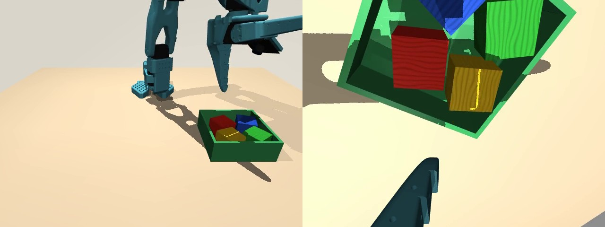

# 🤖 SO-101 仿真数据工厂

在 **[LeRobot 官方 MuJoCo 场景](https://huggingface.co/lerobot/so101-tabletop-mujoco)**中，让机械臂自动把四个方块放进绿盒子，再保存为可训练的数据。

## ⭐ 自动生成训练数据：运行这个

**入口：[collect_official.py](collect_official.py)**。它调用自动控制程序抓放方块，并将成功回合保存为 **LeRobot 训练数据集**。

在 `/home/xcj/so101_vla` 仓库根目录执行，例如采集50条：

```bash
.venv/bin/python myscript/collect_official.py \
  --episodes 50 --max-attempts 100 --seed 200 --preview \
  --root data/tabletop20261023
```

- 🎯 `--episodes 50`：目标保留50条成功示范；最多尝试100回合，失败不保存。达到上限仍不足时会报错，已完成的数据保留。
- 🎲 `--seed 200`：从种子200开始逐回合递增，**各回合会换摆放位置，不是固定场景采集**。
- 📂 `--root`：新数据目录，已有目录不会覆盖；不传则自动按时间命名。
- 🎬 `--preview`：额外保存首条成功示范视频 `preview_success.mp4`。

✅ 采完检查：

```bash
.venv/bin/python myscript/validate_official_data.py --root data/tabletop20261023
```

📦 数据目录包含双相机视频、关节状态、动作、任务指令，以及采集记录 `collection_manifest.json`。**此入口只采集，不启动模型训练。**

## 🧠 自动控制的思路

🧠 **流程**：读取方块位置 → 求解抓取姿态 → 平滑抓放 → 失败重试 → 只保留成功回合。

- 🦾 夹爪朝下，并对齐方块方向，减少推走和掉落。
- 📷 保存前视/腕部画面、关节状态、动作和任务指令。
- 📦 输出 LeRobot 格式，33Hz；记录随机种子，便于复现。
- 🔒 不改官方源码、XML或摩擦参数；这是脚本专家，还不是训练好的策略。



🧪 **本轮验证：20个测试种子全部成功**（小样本，不代表任意场景都能成功）。

🚀 **[快速开始](QUICKSTART.md)** · 📄 **[诊断记录](../outputs/act20261023/README.md)**

| 脚本 | 用途 |
| --- | --- |
| ⭐ [collect_official.py](collect_official.py) | **自动采集新数据，训练数据生成入口** |
| 🦾 [official_teacher.py](official_teacher.py) | 自动控制与演示；要保存训练数据请用上面的采集入口 |
| ✂️ [prepare_fixed_scene.py](prepare_fixed_scene.py) | 从现有数据提取一条固定场景示范，**不重新采集** |
| ✅ [validate_official_data.py](validate_official_data.py) | 检查数据完整性、动作格式和视频 |
| ⚙️ [official_env.py](official_env.py) | 加载固定版本官方环境，供其他脚本调用 |
| 📐 [official_ik.py](official_ik.py) | 计算关节航点，供控制程序调用 |

📦 **已采集50条成功演示**，共66,451帧：[数据目录](../data/official_tabletop_50)。

🎯 **当前固定场景数据**：[fixed_scene_seed200](../data/fixed_scene_seed200)，从上述数据第0条提取，共1,300帧。可用 `.venv/bin/python myscript/prepare_fixed_scene.py` 提取；现有目录不会覆盖，无需重复执行。
